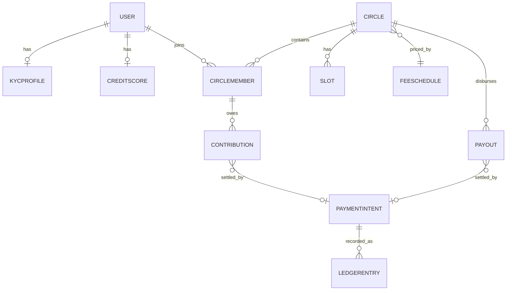
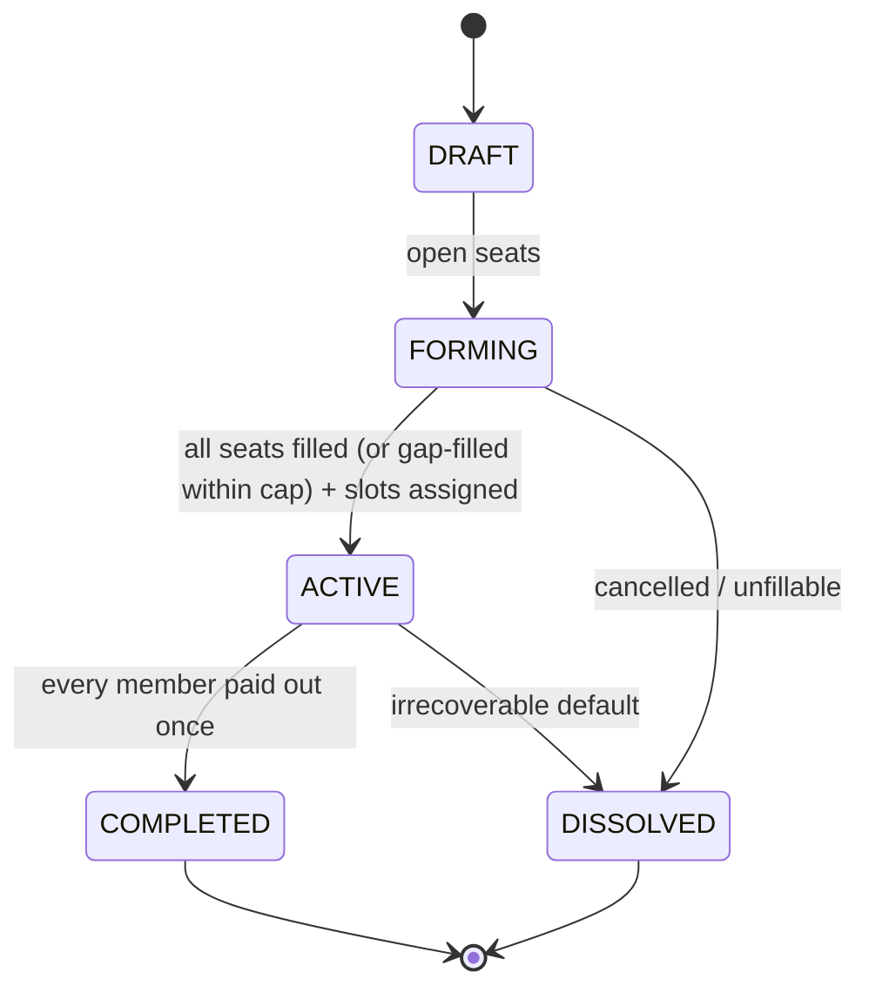
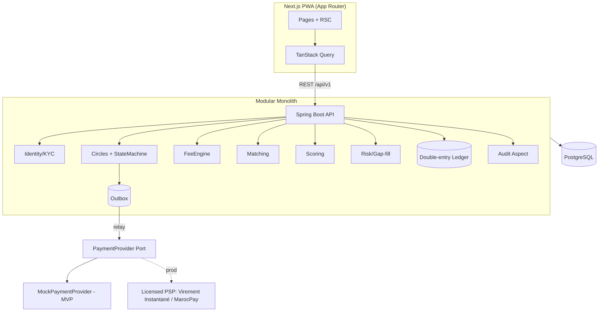

# Daret — Digital Rotating Savings Platform
### Functional & Technical Specification (MVP)

| | |
|---|---|
| **Project** | Daret — digital *daret* / ROSCA platform for Morocco |
| **Document** | Functional & Technical Specification |
| **Version** | 1.0 (MVP scope) |
| **Status** | Draft for build |
| **Audience** | Engineering, product, compliance, payment-partner due diligence |
| **Stack (1-line)** | Java 21 / Spring Boot 3.x · PostgreSQL (double-entry ledger) · Next.js (App Router) PWA · licensed PSP partner behind a payment port · modular monolith |

---

## 1. Executive summary

A *daret* is the Moroccan rotating savings and credit association (ROSCA): a fixed group of people each contribute a set amount every cycle, and one member receives the entire pot each cycle, rotating until everyone has been paid out once. It is run informally today — on trust, among people who already know each other — which caps circle size and excludes anyone without a pre-existing trusted network.

This platform digitizes the daret. Its role is **matching, scoring, scheduling, and trust** — explicitly **not** custodying money. All funds move through a licensed Moroccan payment partner; the platform is the intelligence and coordination layer on top.

The model is proven regionally: Egypt's MoneyFellows digitized the equivalent *gam'eya* into a fintech that raised over $60M, using credit scoring to match members and keeping platform capital exposure thin (it funds an empty slot only when a circle is under-filled, ~7–8% of slots). The same cultural artifact (daret/gam'eya/committee/tanda) is essentially undigitized in Morocco today, which is the opportunity.

---

## 2. Goals & non-goals

### 2.1 MVP goals
- Let verified users **create** and **join** savings circles.
- **Match** members to slot positions using preferences + credit scoring.
- **Schedule and process** contributions and payouts each cycle through a payment partner (mocked in MVP).
- **Manage default risk** with capital-light gap-filling under a hard exposure cap.
- Provide an **immutable, verifiable audit trail** for every financial event.
- Be **fr / ar / darija** ready with proper RTL, and **mobile-first (PWA)**.

### 2.2 Non-goals (explicitly out of MVP scope)
- The platform holding a spendable cash balance (regulatorily prohibited — see §4).
- Issuing electronic money, cards, or credit on the platform's own balance sheet.
- Native mobile apps (PWA only for MVP).
- Cross-border circles / multi-currency (MAD only).
- A secondary market for trading slot positions.

---

## 3. Glossary

| Term | Meaning |
|---|---|
| **Daret / Circle** | A savings group with a fixed number of seats, contribution amount, and cadence. |
| **Seat / Member** | A participant in a circle. |
| **Slot** | A member's position `1..N` in the payout order. Slot 1 = earliest payout, slot N = latest. |
| **Cycle** | One period (e.g. monthly). Each cycle, all members contribute and one member receives the pot. |
| **Contribution** | A member's payment obligation for one cycle. |
| **Pot / Payout** | The sum disbursed to the cycle's recipient (= contribution × seat count). |
| **Position fee** | Optional, transparent value transfer from early-payout takers to late-payout waiters. Disabled in Sharia mode. |
| **Service fee** | The platform's revenue: a flat/percentage facilitation fee, not interest. |
| **Gap-fill** | Platform-funded contribution for an unfilled slot, capped by exposure limit. |
| **PSP** | Payment Service Provider / licensed *établissement de paiement* partner. |

---

## 4. Regulatory & compliance constraints (hard invariants)

These are enforced **in code**, not just documented.

1. **No fund custody.** Under **Loi 103-12** (Moroccan banking law), only licensed banks may receive funds from the public at sight or for terms ≤ 2 years. The platform must never pool/hold member funds on its own balance sheet. All money movement goes through a `PaymentProvider` port backed by a licensed partner. The platform DB stores **claims and intents**, never a spendable balance.
2. **Payment-institution path.** The production money layer rides a licensed *établissement de paiement* partner (own licence requires MAD 3M minimum capital — out of scope for MVP). Morocco's acquiring market opened up in 2025–2026 (CMI demonopolized into a neutral switch; multiple payment institutions activated), and the relevant rails are **Virement Instantané** (instant account-to-account, live since 2023) and **MarocPay** (interoperable m-wallet, ~8M holders). Fast-onboarding option for early integration: **PayZone** (~48–72h activation).
3. **No "interest" anywhere.** Code, DB columns, API fields, and UI copy use `serviceFee` / `positionFee` / `payoutBonus`. Never `interest` / `rate`. See §7 for the Sharia-compatible framing.
4. **Immutable audit.** Every financial state change emits an append-only, hash-chained `AuditEvent` (§13).
5. **KYC gate.** No user may create or join a circle until `KycProfile.status == VERIFIED`. Enforced at service layer.
6. **Data protection (CNDP / Loi 09-08).** PII is tagged, masked in logs/audit by default, and behavioral scoring (profiling) requires CNDP authorization. Plan data residency (EU region or local hosting), not a US identity SaaS.
7. **AML/KYC obligations** attach the moment money pools/moves, even on a partner's licence: identity verification, transaction monitoring, suspicious-activity handling.

---

## 5. The financial model

### 5.1 Mechanics
A circle has `N` seats, contribution `C` per cycle, and runs for `N` cycles. Each cycle the pot is `N × C`; one member receives it. The member in **slot 1** receives the pot first (economically: receives cash early, keeps contributing after — a "borrowing" position). The member in **slot N** receives last (contributes throughout, collects at the end — a "saving" position).

The slot position is the entire financial primitive. The platform's job is to match people who *want* to be early (borrowers) with people happy to wait (savers), and to keep everyone paying.

### 5.2 Revenue & the Sharia question (design decision)
Two configurable layers, decoupled:

- **Service fee (platform revenue):** a flat or percentage facilitation fee per member per circle. This is the platform's income and is framed as a service charge, not interest. Always on.
- **Position fee (peer redistribution):** an optional, transparent value transfer from early-takers to late-waiters, compensating those who wait. The platform facilitates it but does not lend.

**`shariaMode` flag on each circle:**
- `shariaMode = true` → position fee **disabled**. Pure rotation; platform earns only the flat service fee. Fully interest-free.
- `shariaMode = false` → position fee enabled as a transparent, pre-disclosed redistribution (members see exactly what each slot costs/earns before committing).

This makes the Sharia-compatible product the *default-safe* option and a genuine differentiator versus a foreign entrant.

### 5.3 Position-fee curve (when enabled)
A pure, fully-tested function. Reference design:

```
For a circle of N seats, define a per-slot positioning weight that
declines linearly from the earliest to the latest slot:

  weight(k) = (N - k) / (N - 1)        # k = 1..N  → weight 1.0 .. 0.0

  positionFee(k)  = baseFee × weight(k) × tierMultiplier(member)
  payoutBonus(k)  = redistributionShare × (1 - weight(k))

  Invariant: Σ positionFee(k) ≥ Σ payoutBonus(k);
             platform margin = Σ positionFee - Σ payoutBonus (in non-sharia mode)
```

`baseFee`, `redistributionShare`, and `tierMultiplier` live in a `FeeSchedule`. The frontend shows a member exactly what their chosen slot costs or earns **before** they confirm.

### 5.4 Risk & gap-filling
- A missed contribution → member marked `LATE` → retried → `DEFAULTED` after a grace window.
- **Capital-light gap-fill:** if a circle is under-filled at activation, the platform may fund the empty slot via the PSP, recorded as a platform-funded slot, **capped at `maxPlatformExposurePct` (default 10%)**. This is the *only* place platform capital touches a circle. Activation is rejected if filling the gap would exceed the cap.
- Risk is spread across members (continued-payment obligation + scoring at entry), not warehoused on the platform's books.

---

## 6. User roles & permissions (RBAC)

| Role | Capabilities |
|---|---|
| **MEMBER** | Register, complete KYC, create/join circles, view own obligations/payouts, manage profile. |
| **ADMIN** | Manage fee schedules, circles, users; operational oversight. |
| **COMPLIANCE_OFFICER** | Read-only access to the audit chain + integrity verification, KYC review, AML flags. |

Enforced via method-level `@PreAuthorize`. The audit console is readable only by `COMPLIANCE_OFFICER`.

---

## 7. Functional requirements

Each requirement is written as capability + acceptance criteria (AC).

### 7.1 Authentication & onboarding
- **FR-1** Users register with phone/email + password; receive JWT (access + rotating refresh).
  - AC: passwords BCrypt-hashed; refresh rotation; rate-limited login.
- **FR-2** i18n onboarding in fr / ar / darija-latin; Arabic renders RTL.

### 7.2 KYC
- **FR-3** A user submits KYC; status flows `PENDING → VERIFIED | REJECTED`.
  - AC: raw identity documents are **never** stored by the platform — only opaque references from the KYC/payment partner.
- **FR-4** A user with non-`VERIFIED` KYC cannot create or join any circle (enforced server-side).

### 7.3 Credit scoring
- **FR-5** The system computes a `CreditScore` (0–1000, tier A–E) from available signals (payment history, KYC completeness, tenure). In a thin-data market, new users start at a conservative tier weighted toward on-platform behavior.
  - AC: scoring is a tunable strategy; factors stored for explainability; profiling documented for CNDP.

### 7.4 Circle creation
- **FR-6** A verified MEMBER creates a circle: name, `contributionAmount`, `seatCount`, `cycleLengthDays`, `feeSchedule`, `shariaMode`.
  - AC: validation on all fields; circle starts in `DRAFT`/`FORMING`.

### 7.5 Discovery & joining
- **FR-7** Members browse/filter open circles (by amount, cadence, Sharia mode).
- **FR-8** A member joins a circle expressing a **slot preference** (`EARLY | FLEXIBLE | LATE`).
  - AC: KYC + score gate enforced (see FR-11); member sees fee preview before confirming.

### 7.6 Fee preview
- **FR-9** Before committing, a member sees the projected obligation schedule, payout date, and position fee/bonus for a given slot.
  - AC: computed by the `FeeEngine` preview endpoint; no interest framing.

### 7.7 Matching & slot assignment
- **FR-10** On activation, the matching engine assigns slots to maximize filled circles while respecting preferences and the score gate, and returns a per-member rationale.
- **FR-11** **Score gate:** only tier A–B may take slots in the earliest third (high-"borrowing" positions). Lower tiers are eligible for later slots only.

### 7.8 Contribution scheduling & collection
- **FR-12** When a circle activates, the scheduler creates `Contribution` rows per member per cycle with due dates.
- **FR-13** Each cycle, the system issues `COLLECT` payment intents through the PSP.
  - AC: idempotent; outbox-backed so no event is lost; reconciled against PSP status.

### 7.9 Payout disbursement
- **FR-14** When a cycle's contributions settle, the system issues a `DISBURSE` intent to the cycle's recipient for the pot (± position fee/bonus).
  - AC: a member receives exactly one payout across the circle's life; double-payout impossible (ledger invariant).

### 7.10 Default & risk handling
- **FR-15** Missed contribution → `LATE` → retry → `DEFAULTED` after grace; notifications at each step; audit events emitted.
- **FR-16** Under-filled circle may be gap-filled by the platform within `maxPlatformExposurePct`; otherwise activation is rejected.

### 7.11 Notifications
- **FR-17** Members are notified of upcoming contributions, successful payouts, missed payments, and circle status changes (channel-agnostic; SMS/push later).

### 7.12 Compliance console
- **FR-18** A COMPLIANCE_OFFICER can view the audit chain and run integrity verification (recompute the hash chain, flag any break).
- **FR-19** KYC review queue and AML flags are surfaced to compliance.

---

## 8. Domain model

UUID primary keys; `createdAt`/`updatedAt` via JPA auditing.

| Entity | Key attributes | Notes |
|---|---|---|
| **User** | id, contact, passwordHash, roles | Auth identity. |
| **KycProfile** | userId, status, partnerRef | No raw documents stored. |
| **CreditScore** | userId, score, tier, factors(jsonb), computedAt | Recomputed by scoring service. |
| **Circle** | name, contributionAmount, cycleLengthDays, seatCount, status, feeScheduleId, shariaMode | The daret. |
| **CircleMember** | circleId, userId, slotPosition?, standing | `standing` ∈ GOOD/LATE/DEFAULTED. |
| **Slot** | circleId, position(1..N), positionFee, payoutBonus, platformFunded(bool) | Financial primitive. |
| **Contribution** | circleMemberId, cycleIndex, amount, dueDate, status, paymentIntentId | SCHEDULED/PAID/MISSED. |
| **Payout** | circleId, recipientMemberId, cycleIndex, amount, status | Exactly one per member. |
| **FeeSchedule** | baseFee, redistributionShare, tierMultipliers, serviceFee | Drives the curve. |
| **PaymentIntent** | direction(COLLECT/DISBURSE), amount, externalRef, status | Only thing touching money. |
| **LedgerEntry** | account, debit, credit, refType, refId, cycleIndex | Append-only double-entry. |
| **AuditEvent** | actor, action, target, payload(masked), prevHash, hash | Hash-chained. |
| **OutboxEvent** | type, payload, status, createdAt | Transactional outbox. |

### 8.1 Relationships (ER overview)



---

## 9. State machines

### 9.1 Circle lifecycle

Illegal transitions are rejected by an explicit `CircleStateMachine` with a domain exception.

### 9.2 Contribution
`SCHEDULED → PAID` (on settle) · `SCHEDULED → MISSED` (on grace expiry) · `MISSED → PAID` (late recovery).

### 9.3 KYC
`PENDING → VERIFIED | REJECTED`.

---

## 10. Technical architecture

### 10.1 Shape: modular monolith + hexagonal payment boundary
A single Spring Boot application with strong internal module boundaries (`circles`, `scoring`, `risk`, `ledger`, `payments`, `compliance`, `identity`). This keeps transactional integrity across modules — essential when money is involved — and avoids distributed-transaction pain. Split a module into a service only when a real scaling boundary appears.



### 10.2 Tech stack (with rationale)

| Layer | Choice | Why |
|---|---|---|
| Language/Framework | **Java 21 + Spring Boot 3.x** | Transactional, mature security, scheduling; your fluency = velocity. |
| Database | **PostgreSQL 16** | ACID, `jsonb`, derived balances from a ledger. |
| Migrations | **Flyway** | SQL-first, simple. |
| Money model | **Double-entry ledger (Postgres tables)** | Auditable, reconcilable; never mutate balances. (TigerBeetle only if scale demands.) |
| Payment integration | **`PaymentProvider` port** → Mock (MVP) → licensed PSP (PayZone to start) | Regulatory firewall; swap one adapter for prod. |
| Reliability | **Transactional outbox + ShedLock** | No lost financial events; multi-instance-safe schedules. |
| Auth (MVP) | **Spring Security + JWT** | Fast start. |
| Auth (scale) | **Keycloak (self-hosted OIDC)** | MFA + data residency for fintech/CNDP. |
| Mapping/boilerplate | MapStruct + Lombok | DTO mapping, less boilerplate. |
| API docs | Springdoc OpenAPI | Contract for frontend + partners. |
| Frontend | **Next.js (App Router) + TypeScript** | SSR/SEO for discovery; RSC ships less JS to low-end mobile. |
| Delivery | **PWA-first** | Installable, no app-store friction; right for mobile-heavy/underbanked market. |
| Frontend state | TanStack Query + Zustand | Server vs. light client state. |
| Forms/validation | react-hook-form + **Zod** | Shared schema discipline. |
| Styling | Tailwind (logical properties) | RTL-clean. |
| i18n | **next-intl** | fr/ar/darija + RTL. |
| Build | Maven (backend), pnpm (frontend) | — |

### 10.3 Double-entry ledger (the part that's easy to get wrong)
- Every money movement writes **two** `LedgerEntry` rows (debit + credit) that sum to zero, within the same DB transaction as the business state change.
- **Balances are derived** (`SUM(credit) - SUM(debit)` per account), never stored as a mutable field.
- Accounts model claims/positions, **not** platform-owned spendable cash. The platform's books reconcile against the PSP's reported settlement, surfacing any drift.

### 10.4 Payment provider port (regulatory firewall)
```java
public interface PaymentProvider {
    PaymentIntent collect(CollectRequest req);     // pull a contribution
    PaymentIntent disburse(DisburseRequest req);   // send the pot
    PaymentIntentStatus poll(String externalRef);  // reconcile
}
```
- **MVP:** `MockPaymentProvider` — simulates async settlement with a configurable failure rate to exercise default/gap-fill paths.
- **Prod (stubbed TODO):** adapter for the licensed PSP partner.
- Nothing in the system may leak around this boundary.

### 10.5 Reliability: transactional outbox
Financial events are written to an `OutboxEvent` table in the same transaction as the state change, then relayed to the payment port after commit. Guarantees at-least-once delivery with idempotency keys; no event lost on crash.

### 10.6 Scheduling
`@Scheduled` jobs (cycle opening, collection, payout, default sweeps) guarded by **ShedLock** for multi-instance safety.

---

## 11. API specification (REST, `/api/v1`)

| Method | Path | Auth | Purpose |
|---|---|---|---|
| POST | `/auth/register` | public | Register |
| POST | `/auth/login` | public | Login → JWT |
| POST | `/auth/refresh` | public | Rotate token |
| GET/POST | `/kyc` | MEMBER | Submit / check status |
| GET | `/me/score` | MEMBER | Own credit score |
| POST | `/circles` | MEMBER | Create circle |
| GET | `/circles` | MEMBER | Discover (filterable) |
| GET | `/circles/{id}` | MEMBER | Circle detail |
| POST | `/circles/{id}/join` | MEMBER | Join (slotPreference) |
| GET | `/circles/{id}/fee-preview?position=` | MEMBER | Fee/bonus preview |
| POST | `/circles/{id}/activate` | MEMBER/ADMIN | Match + risk + activate |
| GET | `/circles/{id}/schedule` | MEMBER | Contributions & payouts |
| GET | `/me/obligations` | MEMBER | Upcoming contributions |
| GET | `/me/payouts` | MEMBER | Own payouts |
| GET | `/admin/audit` | COMPLIANCE_OFFICER | Audit chain + integrity |

Conventions: Bean Validation on writes; consistent error envelope `{code, message, fieldErrors[]}` via `@ControllerAdvice`; no business logic in controllers.

---

## 12. Data protection & PII handling (CNDP / Loi 09-08)
- `@Pii` field marker; a Jackson filter + a Logback masking converter keep PII out of logs and audit payloads by default.
- Behavioral credit scoring = profiling → requires CNDP authorization, not just a declaration. Build the legal basis in from day one.
- Raw identity documents are never stored — only opaque partner references.
- Data residency: EU region or local hosting; avoid US-headquartered identity SaaS for PII.

---

## 13. Audit & compliance architecture
- `@Audited` annotation + an `AuditAspect` (Spring AOP) capture actor, action, target, and a PII-stripped payload for every annotated service method.
- Each `AuditEvent` stores `prevHash` and its own `hash = SHA-256(prevHash + canonicalPayload)`, forming a tamper-evident chain.
- `ComplianceController` exposes the chain with an **integrity-verification** endpoint that recomputes the chain and flags any break.

---

## 14. Frontend architecture
- **Next.js App Router**, Server Components for discovery/landing (SEO + minimal JS to mobile), Client Components for interactive flows.
- **PWA**: installable, offline-tolerant shell, push-ready.
- **Pages:** Auth · KYC · Discover circles · Create-circle wizard · Circle detail (with fee/payout preview slider) · Join flow (projected obligation + payout date before confirm) · Member dashboard (contributions, payout countdown, standing) · Compliance console (role-gated).
- **i18n/RTL:** next-intl for fr/ar/darija; Arabic RTL via Tailwind logical properties.
- **State:** TanStack Query for server state; optimistic UI only for non-financial actions.

---

## 15. Non-functional requirements
- **Consistency:** financial operations are transactional and idempotent; ledger invariants enforced.
- **Security:** JWT with rotation, BCrypt, method-level authorization, rate limiting on auth/join, PCI concerns delegated to the PSP (platform never handles raw card/account data).
- **Availability:** stateless API horizontally scalable; ShedLock-guarded jobs.
- **Observability:** structured logging (PII-masked), Micrometer + Prometheus/Grafana, Sentry on frontend.
- **Auditability:** every financial event traceable and integrity-verifiable.
- **Performance:** fee preview and discovery responsive on mid-range mobile over constrained networks.

---

## 16. Testing strategy
- **Unit:** `FeeEngine`, `MatchingService`, `CircleStateMachine`, `RiskService` (incl. exposure-cap rejection), ledger invariants.
- **Integration (Testcontainers + Postgres):** full circle lifecycle; missed-contribution → default; gap-fill path; audit-chain integrity; outbox delivery.
- **Frontend:** Vitest + Testing Library; **Playwright E2E** for the money flows (contribute → payout → missed → default).
- Pin Testcontainers via BOM to avoid Docker-engine incompatibility.
- Seed script that spins up a demo circle mid-lifecycle for manual testing.

---

## 17. Infrastructure & deployment
- **Local:** Docker Compose (postgres + adminer + backend + frontend), one-command spin-up.
- **CI/CD:** GitHub Actions (build, test, container publish).
- **Hosting:** containerized; single VPS or managed container platform to launch; EU/local region for residency.
- **Secrets:** env for MVP, plan for Vault; never commit secrets.

---

## 18. Phased delivery roadmap
1. **Skeleton** — monorepo, docker-compose, Flyway baseline, auth, User/KYC, health check.
2. **Circles core** — entities, state machine, create/join (KYC-gated), no money.
3. **Economics** — FeeEngine, slot pricing, fee-preview endpoint + frontend slider, Sharia mode.
4. **Money (mocked)** — PaymentProvider port + MockPaymentProvider, ledger, contributions/payouts, scheduler, outbox.
5. **Risk & matching** — scoring, gating, matching engine, risk/gap-fill cap.
6. **Compliance** — AOP audit aspect, hash chain, PII masking, compliance console.
7. **Polish** — i18n/RTL, error states, seed/demo data, README.

Each phase ≈ one reviewable PR. Pause for review after each.

---

## 19. Risks & open decisions
- **Primary language**: fr-first vs darija-first changes onboarding/trust framing — decide before Phase 1.
- **PSP partner selection**: confirm which licensed *établissement de paiement* exposes the needed COLLECT/DISBURSE + Virement Instantané / MarocPay APIs; PayZone for speed of onboarding.
- **Riba framing review**: have the position-fee redistribution reviewed for Sharia defensibility; ship Sharia mode as default.
- **CNDP filing**: profiling/scoring authorization is a launch dependency, not cleanup.
- **Trust/social layer**: the local differentiator vs. a foreign entrant — invite/reputation mechanics deserve product attention beyond MVP.

---

## 20. References (verify before relying on for legal/regulatory decisions)
- **Loi 103-12** relative aux établissements de crédit et organismes assimilés (Bank Al-Maghrib) — banking law; payment-institution category; deposit-taking restriction.
- **Loi 09-08** — personal data protection (CNDP).
- Bank Al-Maghrib circulaires on *services de paiement* (e.g. 7/W/2016 and amendments).
- Moroccan payment-market reconfiguration (CMI demonopolization; payment-institution activations; Virement Instantané; MarocPay) — 2025–2026 reporting.
- MoneyFellows / regional ROSCA digitization — model and capital-exposure reference.

*This document is an engineering/product specification, not legal advice. Validate all regulatory points with Moroccan counsel and your payment partner before launch.*
